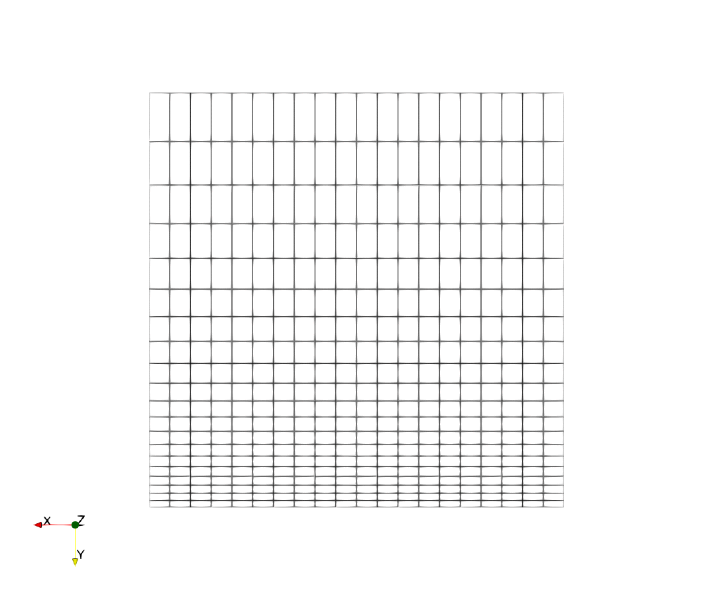
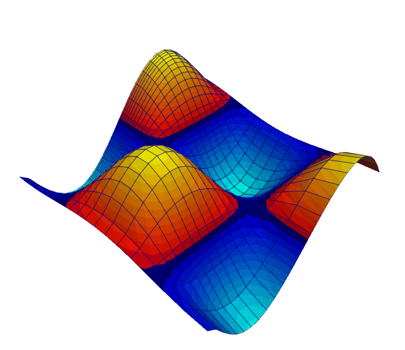
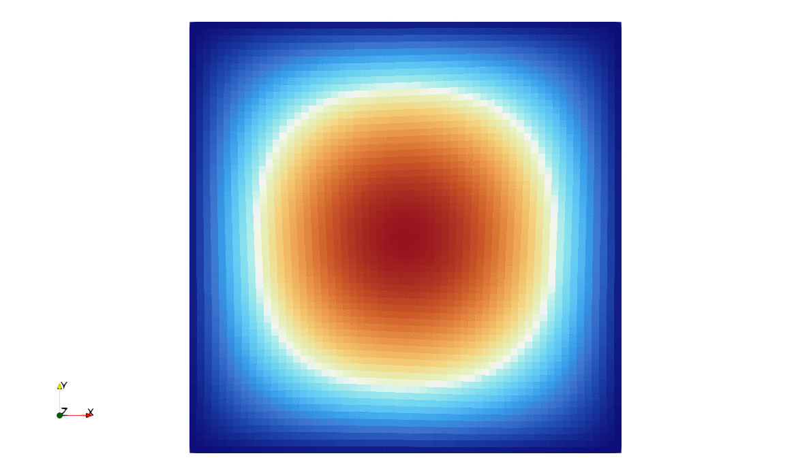
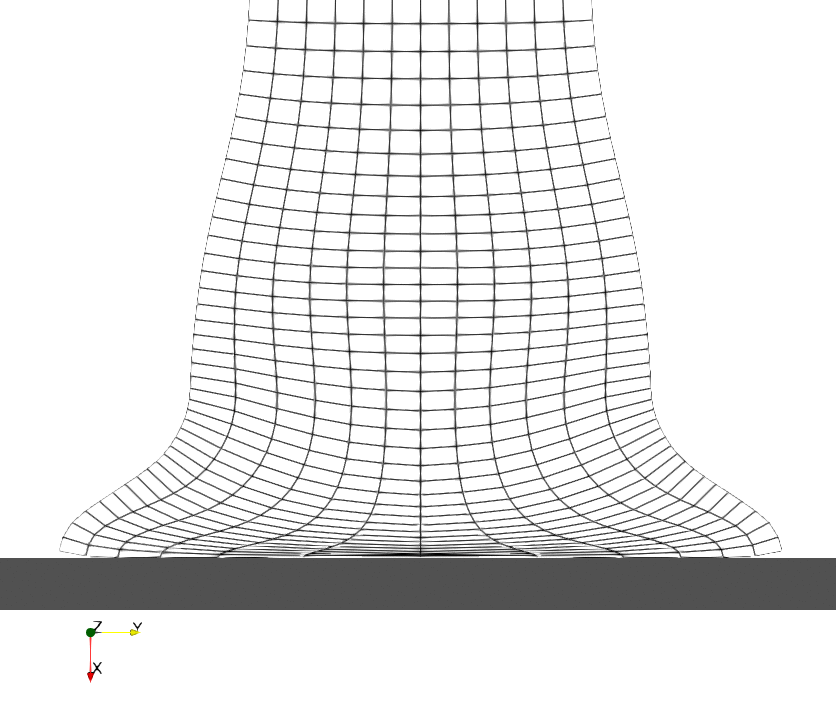
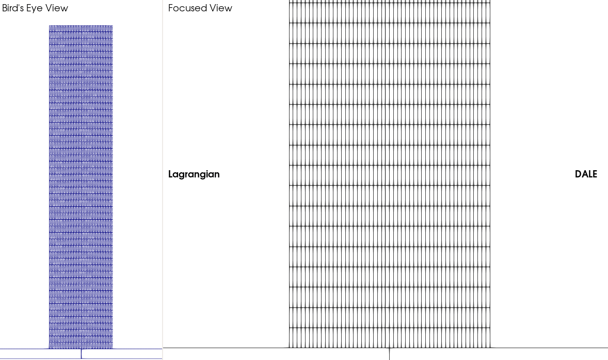
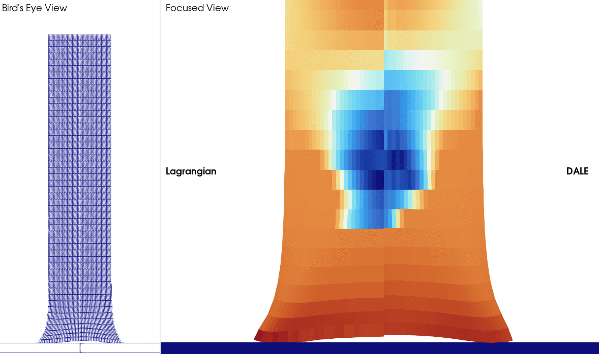

## Linear rezoning and remapping

**Left**: Non-uniform mesh turns uniform;  
**Right**: Field demonstrated by height and color contours remains intact during mesh motion.
Particularly, field extremums are preserved.

    
    

## Cyclic sinusoidal rezoning and remapping

A 60x64 mesh, undergoes sinusoidal rezone, while field properly advects across cells using ACTIV remap.

    

<!--remapping a step function,-->

## Frictionless upsetting a billet,

A wedge of a cylindrical billet, undergoes strain-controlled, frictionless rigid-plastic deformation.

    

## Frictional upsetting a billet

DALE and Lagrangian formulations are compared.

    

## Rezoning the impacting billet

    

## Solution of the impacting billet

DALE and Lagrangian formulations are compared.  
**Left**: Mesh;  
**Right**: $\sigma_\mathrm{eq}$.

    
    

